

<a href="https://itsdg.vercel.app/">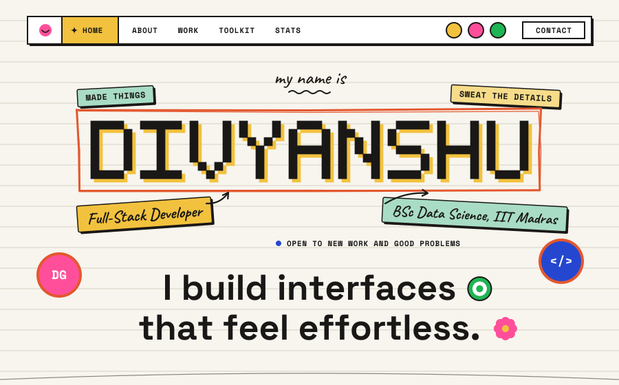</a>

&nbsp;&nbsp;
&nbsp;&nbsp;

  

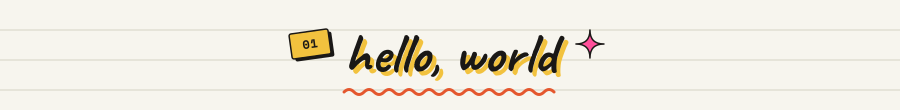
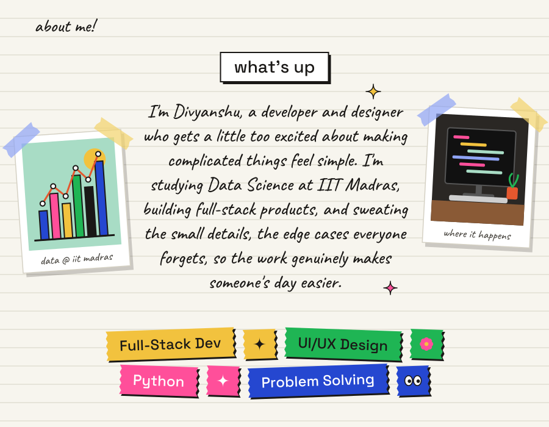

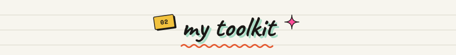
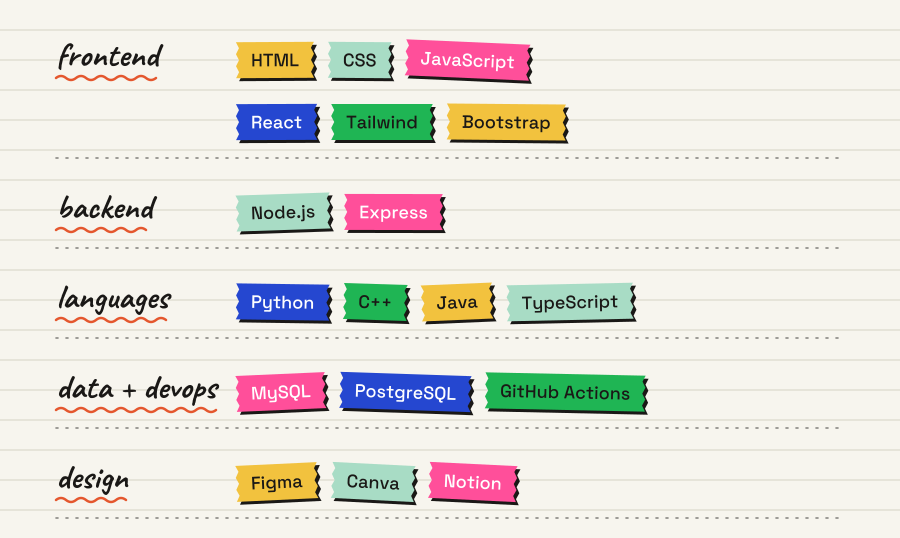

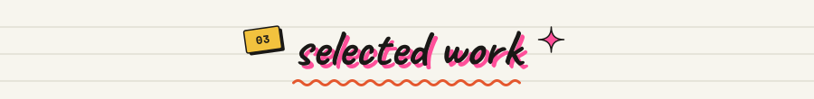
<a href="https://itsdg.vercel.app/">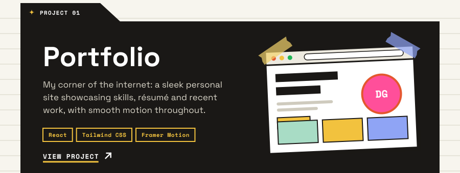</a>
<a href="https://sidcupfamily.vercel.app/">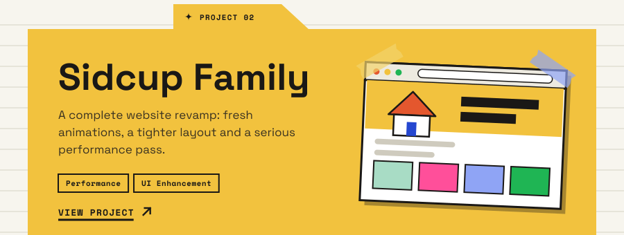</a>
<a href="https://shorturl.at/jaBxw">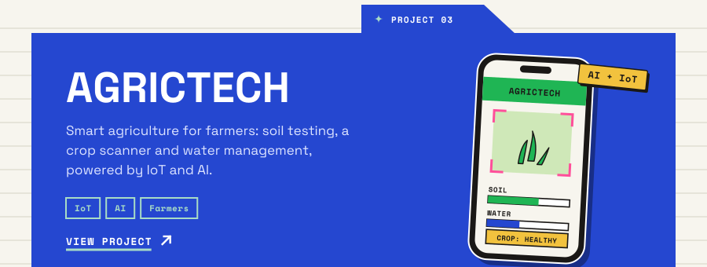</a>

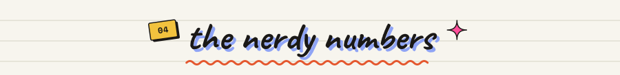

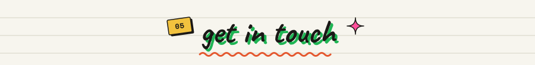
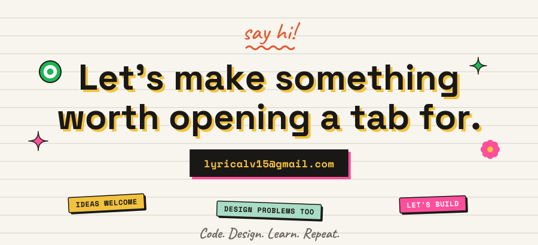

&nbsp;&nbsp;
&nbsp;&nbsp;

  

